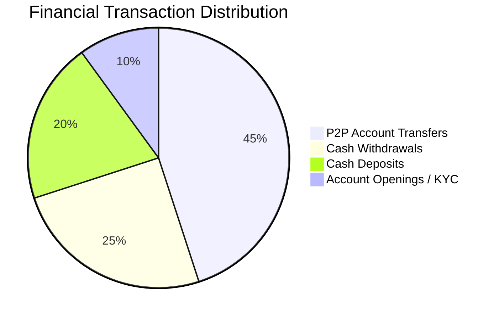
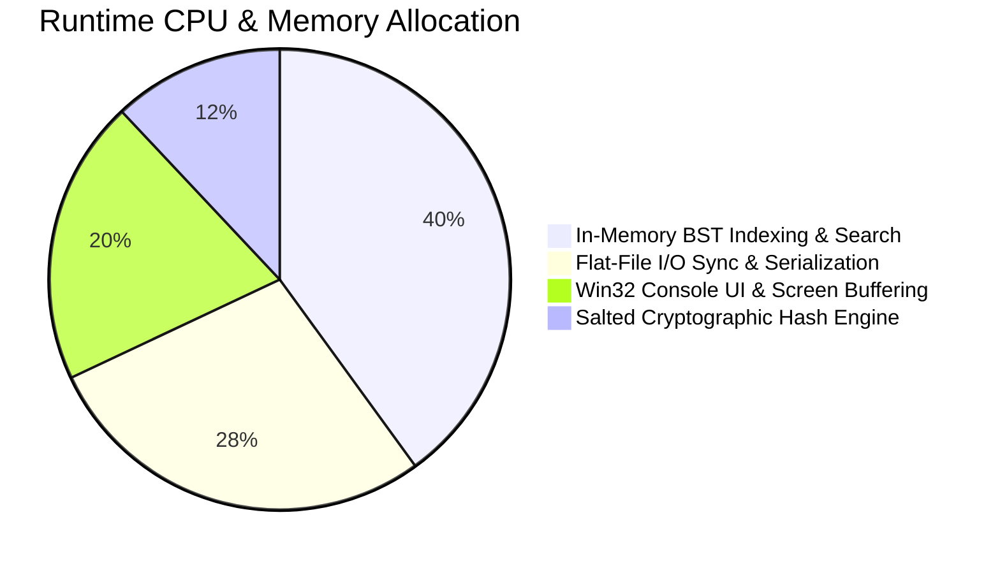
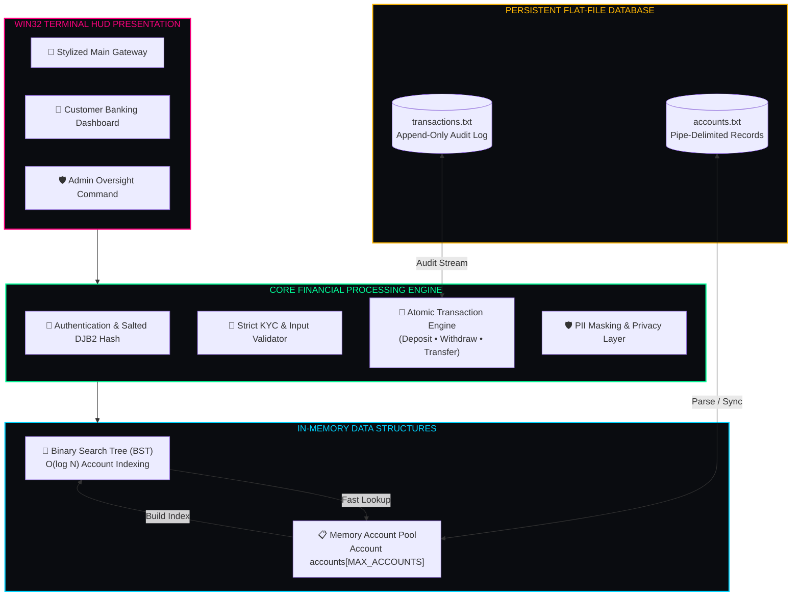

<div align="center">

<h1 style="font-family: 'Cooper Black', 'Arial Black', serif; font-size: rem; letter-spacing: 2px; color: #00ff99; margin-bottom: 2px; text-shadow: 0 0 25px rgba(0, 255, 153, 0.45);">
  🏦 MONEYMATRIX 
</h1>

<h3 style="font-family: 'Bookman Old Style', 'URW Bookman', 'Georgia', serif; font-weight: 500; color: #00d4ff; margin-top: 6px; letter-spacing: 0.8px;">
  ◈ <i>High-Performance Core Banking Engine & Transaction Management System</i> ◈
</h3>

<br/>

[](https://en.wikipedia.org/wiki/C_(programming_language))
[](https://en.wikipedia.org/wiki/Binary_search_tree)
[](https://en.wikipedia.org/wiki/SHA-2)
[](https://microsoft.com)
[](#06-data-schemas)
[](LICENSE)

<br/>

<p align="center" style="font-family: 'Bookman Old Style', 'URW Bookman', serif; font-size: 1.05rem;">
  <b>✦ <a href="#01-system-overview">Overview</a> ✦</b> &nbsp;•&nbsp;
  <b>✦ <a href="#02-console-hud-preview">Console Preview</a> ✦</b> &nbsp;•&nbsp;
  <b>✦ <a href="#03-banking-metrics--telemetry">System Metrics</a> ✦</b> &nbsp;•&nbsp;
  <b>✦ <a href="#04-data-structures--security-logic">BST & Security Logic</a> ✦</b> &nbsp;•&nbsp;
  <b>✦ <a href="#05-system-architecture">Architecture</a> ✦</b> &nbsp;•&nbsp;
  <b>✦ <a href="#06-data-schemas">File Schemas</a> ✦</b> &nbsp;•&nbsp;
  <b>✦ <a href="#07-quick-start">Quick Start</a> ✦</b> &nbsp;•&nbsp;
  <b>✦ <a href="#08-operational-workflows">Workflows</a> ✦</b>
</p>

---

</div>

<h2 id="01-system-overview" style="font-family: 'Bookman Old Style', 'URW Bookman', 'Georgia', serif; color: #00ff99;">🌌 01. System Overview</h2>

<p style="font-family: 'Bookman Old Style', 'URW Bookman', serif; font-size: 1.05rem; line-height: 1.7;">
<b>MoneyMatrix</b> is a high-performance, console-based banking management and transaction processing engine engineered in <b>pure C</b>. Built with algorithmic efficiency and financial data security at its foundation, MoneyMatrix provides a complete dual-tier banking ecosystem: a customer-facing portal for seamless cash deposits, withdrawals, peer-to-peer (P2P) transfers, and account statements, coupled with an administrative command terminal for user governance and credential recovery.
</p>

```
  ┌─────────────────────────┐      ┌─────────────────────────┐      ┌─────────────────────────┐
  │  👤 User / Admin Auth   │ ──❯  │ 🌳 In-Memory BST Index │ ──❯  │ 💾 Pipe Flat-File DB    │
  │    (Salted DJB2 Hash)   │      │    O(log N) Fast Lookup │      │ (accounts/transactions) │
  └─────────────────────────┘      └─────────────────────────┘      └─────────────────────────┘
```

> [!NOTE]
> **Zero Database Dependencies**: MoneyMatrix operates natively without external database daemons, utilizing an in-memory **Binary Search Tree (BST)** for sub-millisecond lookups synchronized atomically with structured persistent flat-files.

---

<h2 id="02-console-hud-preview" style="font-family: 'Bookman Old Style', 'URW Bookman', 'Georgia', serif; color: #00ff99;">📸 02. Console HUD Preview</h2>

<div align="center">

### ◈ 1. Stylized Main Menu HUD
<kbd>
  
</kbd>
<br/>
<sub style="font-family: 'Bookman Old Style', 'URW Bookman', serif;"><b>◈ Figure 1.0:</b> Central access gateway featuring dynamic text centering, Win32 ANSI palette styling, and dual portal routing.</sub>

<br/><br/>

### ◈ 2. Customer KYC & Account Enrollment
<kbd>
  
</kbd>
<br/>
<sub style="font-family: 'Bookman Old Style', 'URW Bookman', serif;"><b>◈ Figure 1.1:</b> Real-time KYC validation interface enforcing strict 12-digit Aadhaar, 10-digit mobile, and masked password inputs.</sub>

<br/><br/>

### ◈ 3. User Banking & Transaction Terminal
<kbd>
  
</kbd>
<br/>
<sub style="font-family: 'Bookman Old Style', 'URW Bookman', serif;"><b>◈ Figure 1.2:</b> Active account terminal showing real-time balance metrics, atomic cash deposits, withdrawals, and P2P transfers.</sub>

<br/><br/>

### ◈ 4. Administrative Command Center
<kbd>
  
</kbd>
<br/>
<sub style="font-family: 'Bookman Old Style', 'URW Bookman', serif;"><b>◈ Figure 1.3:</b> Privileged administrative oversight dashboard displaying global account directories, soft deletion, and security overrides.</sub>

</div>

---

<h2 id="03-banking-metrics--telemetry" style="font-family: 'Bookman Old Style', 'URW Bookman', 'Georgia', serif; color: #00ff99;">📊 03. Banking Metrics & Telemetry</h2>

### 🥧 Transaction Operation Spectrum


### 🛰️ Subsystem Execution Profile


---

<h2 id="04-data-structures--security-logic" style="font-family: 'Bookman Old Style', 'URW Bookman', 'Georgia', serif; color: #00ff99;">🔍 04. Data Structures & Security Logic</h2>

<p style="font-family: 'Bookman Old Style', 'URW Bookman', serif; font-size: 1.02rem;">
MoneyMatrix employs rigorous algorithmic structures to maintain microsecond performance and strong data confidentiality:
</p>

### 🌳 1. Binary Search Tree (BST) Indexing
To avoid costly linear disk scans ($O(N)$), accounts are mapped into an in-memory Binary Search Tree on boot:

```c
typedef struct BSTNode {
    long long account_number;    // Search Key (10-digit UID)
    int account_index;           // Direct Pointer to Account Array
    struct BSTNode *left;
    struct BSTNode *right;
} BSTNode;
```

| Operation | Array Linear Scan | MoneyMatrix BST Engine | Performance Gain |
| :--- | :---: | :---: | :---: |
| **Account Lookup** | $O(N)$ | **$O(\log N)$** | ⚡ **Instantaneous** |
| **Account Insertion** | $O(1)$ amortized | **$O(\log N)$** | ⚡ **Structured** |
| **Transfer Validation** | $2 \times O(N)$ | **$2 \times O(\log N)$** | ⚡ **Atomic Speed** |

---

### 🔐 2. Salted Cryptographic Password Hashing (SHA-256)
Credentials are never stored in plain text. Input characters are salted with a secret cryptographic key (configured via `MONEYMATRIX_SECRET_KEY` in `.env` or system environment variables) and digested via NIST FIPS 180-4 standard **SHA-256**:

$$\text{Digest} = \text{SHA256}(\text{Plaintext Password} \mathbin{\Vert} \text{SECRET\_KEY})$$

Authentication uses **constant-time comparisons** (`constantTimeCompare`) to resist timing side-channel attacks, and automatic backward-compatible legacy hash upgrades.

---

### 🛡️ 3. Dynamic PII Data Masking
Personally Identifiable Information (PII) is automatically masked during display to shield confidential records from shoulder surfing:

| Sensitive Field | Raw KYC Value | Masking Rule | Terminal Output |
| :--- | :---: | :---: | :--- |
| **Aadhaar UID** | `410324909972` | Reveal Last 4 | `********9972` |
| **Mobile Number** | `9548014400` | Reveal Last 4 | `******4400` |
| **Email Address** | `priyanshu@gmail.com` | Reveal Domain | `*******@gmail.com` |
| **Password Input** | `secret123` | Real-time `_getch()` | `*********` |

> [!TIP]
> **Masked Input Security**: `getMaskedInput()` captures raw keystrokes character-by-character via `_getch()`, prints `*` in real-time, and handles backspaces cleanly without echo leaks.

---

<h2 id="05-system-architecture" style="font-family: 'Bookman Old Style', 'URW Bookman', 'Georgia', serif; color: #00ff99;">🧬 05. System Architecture</h2>



---

<h2 id="06-data-schemas" style="font-family: 'Bookman Old Style', 'URW Bookman', 'Georgia', serif; color: #00ff99;">📄 06. Data Schemas</h2>

<details open>
<summary><b>📋 <code>accounts.txt</code> — Customer Master Ledger</b></summary>

Pipe-delimited format holding customer KYC records, hashed credentials, and account statuses.

```text
<AccNo>|<FirstName>|<LastName>|<FatherName>|<MotherName>|<Aadhaar>|<Mobile>|<Email>|<DD-MM-YYYY>|<Address>|<Type>|<User>|<HashedPass>|<Balance>|<IsActive>
```

```text
1940562280|PRIYANSHU|PUNDIR|VIRENDRA PUNDIR|SUNITA PUNDIR|410324909972|9548014400|user@gmail.com|12-01-2004|DEHRADUN|SAVINGS|nanu|4e25e75d2b466bd4|500501.00|1
```
</details>

<details open>
<summary><b>💳 <code>transactions.txt</code> — Immutable Transaction Audit Trail</b></summary>

Append-only log tracking all deposits, withdrawals, and inter-account fund transfers.

```text
<TransID>|<Type>|<Amount>|<Timestamp>|<SourceAcc>|<TargetAcc>
```

```text
1750915580803|Transfer|501.00|2025-06-26 10:56:20|1390645810|1940562280
```
</details>

---

<h2 id="07-quick-start" style="font-family: 'Bookman Old Style', 'URW Bookman', 'Georgia', serif; color: #00ff99;">🚀 07. Quick Start</h2>

### 📋 Prerequisites
- **Compiler**: GCC / MinGW (C99 or higher), Clang, or MSVC
- **Operating System**: Windows (Native Win32 Console API integration for `conio.h`, `windows.h`, `gotoxy`, and color attributes)

### 🛠️ Build & Compilation

```bash
# Option 1: Using GCC / MinGW
gcc -std=c99 MONEYMATRIX.c -o MONEYMATRIX.exe

# Option 2: Using Clang
clang -std=c99 MONEYMATRIX.c -o MONEYMATRIX.exe

# Option 3: Using MSVC (Developer Command Prompt)
cl MONEYMATRIX.c /Fe:MONEYMATRIX.exe
```

### ⚡ Launch Engine
```bash
# Execute pre-compiled or freshly built binary
./MONEYMATRIX.exe
```

---

<h2 id="08-operational-workflows" style="font-family: 'Bookman Old Style', 'URW Bookman', 'Georgia', serif; color: #00ff99;">🎮 08. Operational Workflows</h2>

### 🔑 Administrative Credentials & Environment Variables
| Role | Configuration Variable | Default Username | Password Storage |
| :--- | :--- | :---: | :--- |
| **System Admin** | `MONEYMATRIX_ADMIN_USER`, `MONEYMATRIX_ADMIN_PASS` | `admin` | Configured in private `.env` (Zero Hardcoded Passwords) |
| **Secret Salt** | `MONEYMATRIX_SECRET_KEY` | — | Configured in private `.env` |

> [!IMPORTANT]
> **Zero Hardcoded Secrets**: MoneyMatrix does not store administrative passwords in plaintext source code. Administrative credentials are read dynamically from your local, private `.env` configuration file (see [`.env.example`](.env.example)). Both customer and administrative login gateways are protected by automated rate-limiting (3 failed attempts trigger security lockouts).

### 👤 Customer Operations Flow
1. **Enrollment**: Select `1` from Main Menu & complete KYC verification. Note your generated 10-digit Account Number.
2. **Authentication**: Select `2` to log in via **Account Number** or **Username** with masked password verification.
3. **Banking Transactions**:
   - **`1` Deposit**: Enter amount to immediately credit your balance and log an audit trail.
   - **`2` Withdraw**: Checks balance against requested amount to prevent overdrafts.
   - **`3` Transfer**: Validates target account in the BST, blocks self-transfers, and executes atomic double-entry balance adjustment.
   - **`4` Statement**: Inspect your full tabular transaction history with timestamping.
   - **`5` Profile**: Review your profile with PII masked for privacy.

---

<h2 id="09-disclaimer" style="font-family: 'Bookman Old Style', 'URW Bookman', 'Georgia', serif; color: #00ff99;">🛡️ 09. Security & Disclaimer</h2>

> [!CAUTION]
> **ACADEMIC & DEMONSTRATION PURPOSE.**  
> MoneyMatrix demonstrates low-level systems programming, data structure implementations, and banking logic in C. For commercial production environments, integration with hardware security modules (HSM) and TLS encrypted socket streams is recommended.

---

<h2 id="10-license" style="font-family: 'Bookman Old Style', 'URW Bookman', 'Georgia', serif; color: #00ff99;">📜 10. License</h2>

Distributed under the **[MIT License](LICENSE)**.

<div align="center">

---

⭐ **Star this repository if you find MoneyMatrix inspiring!** ⭐

<p style="font-family: 'Bookman Old Style', 'URW Bookman', serif; color: #64748b; margin-top: 8px;">
  Crafted with ⚡ by <b>Priyanshu Pundir</b>
</p>

</div>